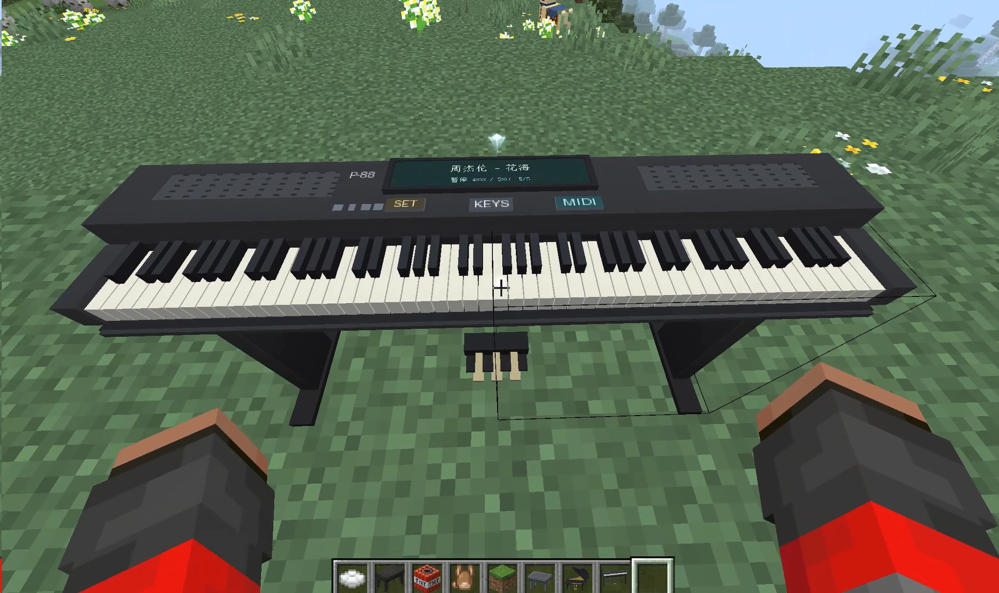
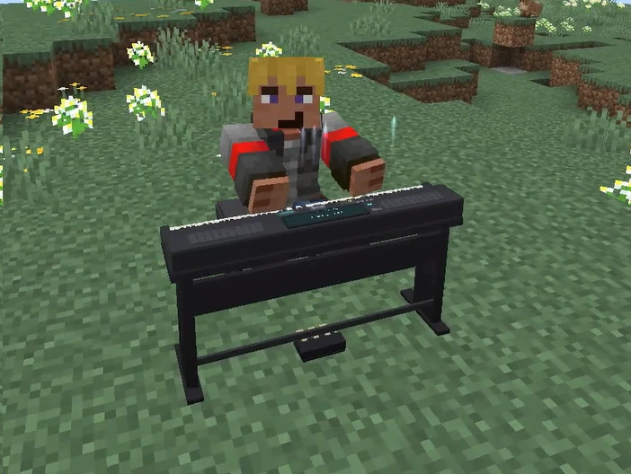
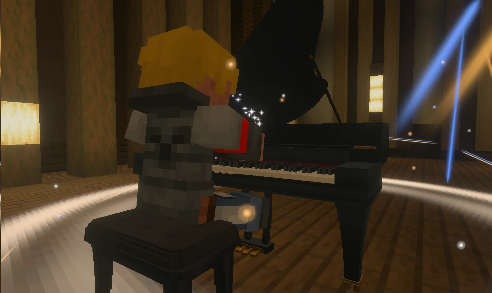
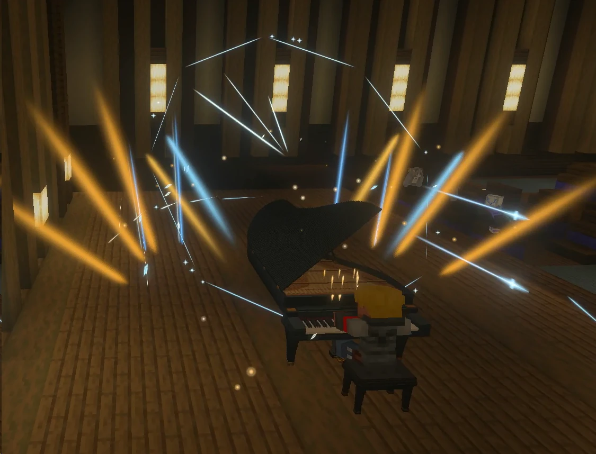
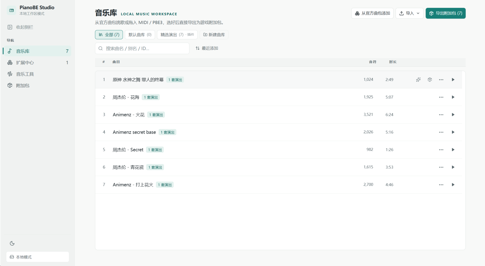

# PianoBE

**在 Minecraft 基岩版中演奏钢琴、播放 MIDI，并为音乐打造自己的舞台。**

PianoBE 是一套 Minecraft Bedrock Edition 钢琴附加包与创作工具。它把可实时演奏的 3D 钢琴、MIDI 播放器、音乐存储和插件化视觉演出带进游戏；配套的 PianoBE Studio 则负责管理曲库、扩展和附加包。

**[打开 PianoBE Studio](https://piano.mcxfj.top/)** · [B 站演示视频](https://www.bilibili.com/video/BV1jLD9BzE5D) · [交流群](https://qm.qq.com/q/KUgqkHM5uS) · [GitHub Issues](https://github.com/XiaoYangx666/pianoBE/issues)



## PianoBE 2.0

### 不只是一个音乐播放器

PianoBE 的钢琴拥有真实的 3D 琴键。你可以直接对准琴键演奏，也可以打开钢琴面板使用文字演奏和 MIDI 播放功能。

- **可演奏的钢琴**：P-88 电子琴与三角钢琴模型，琴键可交互。
- **五套钢琴音色**：标准钢琴、经典三角钢琴、明亮三角钢琴、原声立式钢琴和复古电钢。
- **力度响应**：根据演奏力度切换采样层并调整音量。
- **独立运行**：每架钢琴拥有自己的播放队列和播放状态。

### MIDI 播放与音乐管理

把 MIDI 曲目带进 Minecraft，使用钢琴播放和管理自己的音乐。

- 支持 MIDI 转换为 PianoBE 使用的 PBE3 播放格式。
- 曲库浏览、搜索、播放队列、播放列表和播放进度控制。
- 支持暂停、继续、跳转和选择歌曲演出方式。
- **音乐存储卡**：保存多首自定义歌曲，可调整顺序、整卡播放或加入队列。
- **世界全局曲库**：管理员可以导入和管理世界共享歌曲，玩家通过钢琴浏览和播放。
- 支持内嵌曲库；BDS 服务器专用包可以连接自托管后端使用远程曲库。

### 插件化演出

歌曲不必只是音符。PianoBE 的插件系统可以把歌曲、音色和视觉能力组合起来：

- **歌曲与演出**：歌曲插件可以附带自己的演出编排，也可以作为普通 MIDI 播放。
- **视觉特效**：粒子、画笔和其他演出效果。
- **舞台元素**：琴型、舞台道具和视觉主题。
- **音色扩展**：按需添加钢琴音色与采样。
- **自由组合**：歌曲不需要强制绑定某个特效插件；导出时选择需要的扩展即可。

## 游戏画面

<table>
  <tr>
    <td width="50%">
      
      <p align="center"><strong>实时演奏</strong></p>
    </td>
    <td width="50%">
      
      <p align="center"><strong>三角钢琴</strong></p>
    </td>
  </tr>
</table>

### 舞台视觉效果



## PianoBE Studio

[PianoBE Studio](https://piano.mcxfj.top/) 是配套的 Web 工作台。无需手动修改附加包源码，就可以准备音乐内容、选择插件并生成游戏附加包。



Studio 提供：

- **音乐库**：从官方曲包添加歌曲，或导入自己的 MIDI / PBE3 文件。
- **扩展中心**：浏览和添加歌曲、音色及视觉扩展。
- **附加包生成**：选择歌曲与插件，自定义包信息并导出 `.mcaddon`。
- **音乐工具**：检查 MIDI / PBE3、生成游戏内分段导入码。
- **音频转 MIDI**：在浏览器本地运行转录模型，将音频转换为 MIDI。

## 快速开始

### 环境要求

- Minecraft Bedrock Edition **26.60 或更新版本**。
- 不需要开启「Beta APIs」实验。
- 同时启用 PianoBE 行为包和资源包。

### 安装并开始演奏

1. 打开 [PianoBE Studio](https://piano.mcxfj.top/)。
2. 进入「音乐库」，从官方曲包添加歌曲，或导入自己的 `.mid` / `.pbe3` 文件。
3. 按需前往「扩展中心」添加音色或演出插件。
4. 在「附加包」页面确认内容并导出 `.mcaddon`。
5. 使用 Minecraft 打开导出的文件，将行为包和资源包导入游戏。
6. 创建世界并启用这两个包。
7. 从创造物品栏取出钢琴并放置。对准琴键右键即可演奏；右键钢琴面板右侧的青色按钮，可以打开文字演奏和 MIDI 菜单。

单机与普通联机世界使用 Studio 导出的客户端附加包即可。

### 为已有世界添加歌曲

如果不想重新导出或安装整个附加包，可以使用分段导入码把自定义歌曲写入音乐存储卡：

1. 在 Studio「音乐工具」中打开 MIDI / PBE3 导入码工具。
2. 导入文件并生成分段导入码。
3. 将音乐存储卡插入钢琴。
4. 打开钢琴的「MIDI 播放器」→「导入 MIDI」，按顺序输入各段导入码。

普通玩家的导入权限由管理员控制；管理员也可以使用游戏内命令 `/pbe:pbe_library` 管理世界全局曲库。

## BDS 服务器：交给 Agent 安装

服主不需要手动研究构建、Docker、令牌和附加包目录。把下面这段提示词交给一个能够访问服务器文件、执行命令并管理 BDS 的 Agent：

```text
请在当前机器上为现有 Minecraft Bedrock Dedicated Server 部署 PianoBE 2.0。

先检查系统、BDS 版本与目录、目标世界、Docker 可用性、网络和端口，并备份准备修改的配置。然后从 https://github.com/XiaoYangx666/pianoBE 获取 main 分支，优先使用仓库提供的 Docker Compose 方式部署后端，确保数据库和配置持久化。接着装配并安装 BDS 专用附加包，绑定到指定世界，配置所需的 BDS 脚本模块权限、后端地址和令牌。为游戏端创建独立的 user 令牌；admin 令牌只用于管理页面。

完成后验证后端 /api/health、BDS 加载日志和游戏内远程曲库。不要覆盖世界存档、玩家数据或其他附加包，不要擅自更改世界实验设置；遇到冲突、权限不足或需要高风险变更时先停下来说明并询问。
```

BDS 专用包使用远程曲库，不包含客户端版内嵌曲库，因此需要同时运行 PianoBE 后端。Agent 可根据服务器实际布局选择直接部署或下载附加包后安装。

- [Agent 安装提示词与后端部署参考](packages/server/README.md#服主安装交给-agent)
- [BDS 配置与远程曲库技术说明](packages/addon/README.md#bds-配置agent-维护者参考)

## 文档

| 文档 | 内容 |
|---|---|
| [Addon 使用说明](packages/addon/README.md) | 游戏内演奏、音乐存储、曲库、BDS 配置 |
| [Server 后端指南](packages/server/README.md) | 后端启动、Docker、BDS 部署、令牌和 API |
| [开发与贡献指南](docs/development.md) | 开发环境、测试、构建、仓库架构和曲库维护 |
| [VFX 文档](docs/vfx/README.md) | 舞台视觉与特效系统 |
| [PBE3 格式说明](docs/pbe3-format.md) | PianoBE 音乐数据格式 |

## 版本兼容性

**PianoBE 2.0 是一次破坏性更新。**

2.0 不提供 1.x 世界数据迁移流程。旧版本世界中的钢琴、音乐存储卡和已导入曲目不能直接迁移。请在新世界中安装 2.0；BDS 也需要使用新世界。

## 反馈与贡献

遇到安装或游玩问题，请通过 [GitHub Issues](https://github.com/XiaoYangx666/pianoBE/issues) 反馈。建议附上 Minecraft 版本、设备平台、复现步骤和报错信息。

开发环境、测试、构建及曲库贡献方式见[开发与贡献指南](docs/development.md)。

## 许可证

- **除 `packages/addon` 外的代码**（Core、Studio、Server、Web、UI 等）：[CC BY-NC 4.0](LICENSE)，允许非商业使用、修改和再分发，需保留署名；禁止商业使用。
- **`packages/addon`**：专有软件，All Rights Reserved。仅允许最终用户安装和游玩，不得再分发、改包或复用其代码与素材。商业授权及其他授权请联系作者，详见 [Addon LICENSE](packages/addon/LICENSE)。
- 第三方模型与运行时依赖遵循各自许可证，详见 [THIRD_PARTY_NOTICES.md](THIRD_PARTY_NOTICES.md)。
- 钢琴采样的来源与授权见 [Addon 音频素材声明](packages/addon/rp/THIRD_PARTY_NOTICES.md)。
